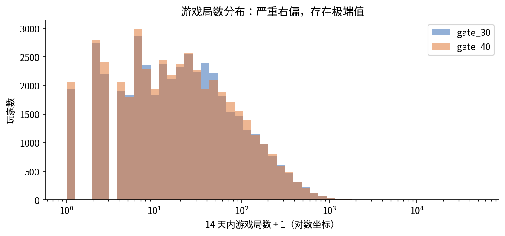
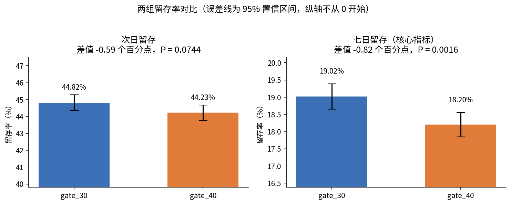
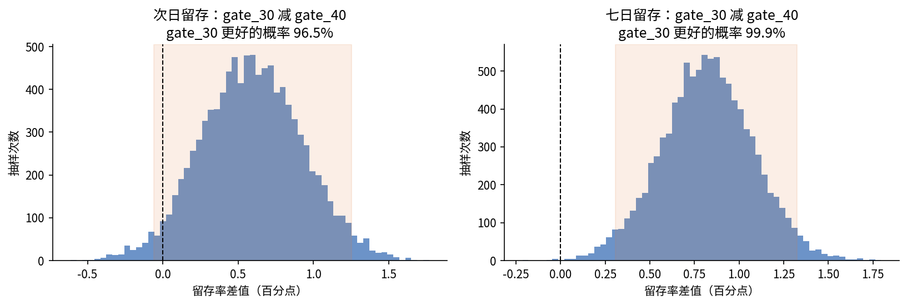

# 手游 A/B 实验分析：关卡门槛该放在第 30 关还是第 40 关？

基于 Cookie Cats 手游 9 万名玩家的随机实验数据，完整走一遍线上 A/B 实验的分析流程：分流检查、统计功效、假设检验、自助法验证、护栏指标和多重检验校正，最终给出上线建议。

**技术栈：** Python（pandas、NumPy、SciPy、matplotlib）· 两样本比例 Z 检验 · 卡方检验 · Mann-Whitney U 检验 · 自助法 · Holm 校正

## 结论速览

- **建议保留第 30 关门槛，不推迟到第 40 关。** 推迟后七日留存（核心指标）从 19.02% 降至 18.20%，下降 **0.82 个百分点**（相对下降 **4.3%**），P = 0.0016，经多重检验校正后仍显著；自助法下对照组更好的概率为 **99.9%**
- 次日留存下降 0.59 个百分点，但不显著（P = 0.074）
- 护栏指标游戏局数两组基本持平，没有发现明显损害
- **风险提示：** 两组人数比例偏离 50:50（P = 0.0086），存在样本比例不匹配的迹象，正式决策前应先排查分流和埋点

## 实验设计

| 组别 | 门槛位置 | 玩家数 |
|---|---|---|
| gate_30（对照组） | 第 30 关 | 44,700 |
| gate_40（实验组） | 第 40 关 | 45,489 |

| 类型 | 指标 | 说明 |
|---|---|---|
| 核心指标 | 七日留存 | 安装 7 天后是否回来玩，作为决策依据 |
| 次要指标 | 次日留存 | 安装 1 天后是否回来玩 |
| 护栏指标 | 游戏局数 | 安装后 14 天内玩了多少局，确保新方案不损害活跃度 |

## 分析过程

### 1. 数据检查

- 90,189 名玩家，没有重复和缺失
- 游戏局数严重右偏：中位数 16 局，4.4% 的玩家一局没玩
- 发现一名异常玩家：14 天玩了 49,854 局（每天约 3,561 局），是第二名的 17 倍，判断为测试账号或脚本。留存分析保留全部玩家，护栏指标分析剔除这名玩家



### 2. 分流检查

做结论之前，先确认随机分组本身没有问题。按 50:50 设计，两组应各约 45,095 人，实际是 44,700 和 45,489。卡方拟合优度检验 **χ² = 6.90，P = 0.0086**，偏离超出了随机波动范围，提示分流或数据记录可能存在问题。实际工作中，出现样本比例不匹配时应先排查原因，再使用实验结论。

### 3. 统计功效

在显著性水平 5%、统计功效 80% 的条件下：

| 指标 | 对照组基线 | 检测 1 个百分点差异所需每组人数 | 实际每组人数 | 最小可检测差异 |
|---|---|---|---|---|
| 次日留存 | 44.82% | 38,737 | 44,700 | 0.93 个百分点 |
| 七日留存 | 19.02% | 23,688 | 44,700 | 0.74 个百分点 |

样本量足以检测出 1 个百分点左右的留存差异。

### 4. 核心指标检验

| 指标 | gate_30 | gate_40 | 差值（百分点） | 95% 置信区间 | 相对变化 | P 值 | Holm 校正后 P 值 |
|---|---|---|---|---|---|---|---|
| 次日留存 | 44.82% | 44.23% | −0.59 | [−1.24, 0.06] | −1.3% | 0.074 | 0.074 |
| **七日留存** | **19.02%** | **18.20%** | **−0.82** | **[−1.33, −0.31]** | **−4.3%** | **0.0016** | **0.0031** |



### 5. 自助法验证

对两组各重复抽样 10,000 次，得到留存率差值的分布，结果与 Z 检验一致：

| 指标 | 差值 95% 区间（百分点） | gate_30 更好的概率 |
|---|---|---|
| 次日留存 | [−0.06, 1.25] | 96.5% |
| 七日留存 | [0.31, 1.32] | **99.9%** |



### 6. 护栏指标：游戏局数

游戏局数严重右偏，所以同时看均值、中位数和非参数检验：

| 口径 | gate_30 | gate_40 | 结果 |
|---|---|---|---|
| 均值（剔除异常玩家） | 51.34 | 51.30 | 差值 95% 自助法区间 [−1.29, 1.37]，包含 0 |
| 中位数 | 17 | 16 | — |
| Mann-Whitney U 检验 | — | — | P = 0.051，未达到 5% 显著水平 |

两组活跃度基本持平，推迟门槛没有带来更多游戏局数。

### 7. 多重检验校正

同时检验了两个留存指标，用 Holm 方法校正 P 值后，七日留存（P = 0.0031）仍然显著，次日留存仍不显著，结论不变。

## 建议与解释

**建议：** 保留第 30 关的门槛。推迟门槛不仅没有提升留存，反而让七日留存下降约 4.3%；对于一款依赖长期活跃和付费的手游，这是不能接受的损失。

**可能的解释：** 门槛强制玩家暂停，反而延长了游戏的新鲜感，玩家更愿意过几天再回来；门槛推迟后，玩家一口气玩得更久，更快感到厌倦。

**局限：**
- 存在样本比例不匹配的迹象，需要先排查分流
- 只有次日和七日留存，看不到长期留存和付费收入，而门槛位置还会直接影响付费
- 没有玩家的历史特征，无法做分层分析；也不能按游戏局数分层，因为局数本身受实验影响，按它分组会引入偏差

## 项目结构与运行

```
├── README.md
├── requirements.txt
├── data/cookie_cats.csv               # 原始数据（2.7MB）
├── notebooks/cookie_cats_ab_test.ipynb
├── figures/                           # 图表
└── results/summary.json               # 关键数字汇总
```

安装依赖后运行笔记本：`pip install -r requirements.txt`，也可以直接在 Google Colab 上运行。

**数据来源：** Kaggle "Mobile Games A/B Testing – Cookie Cats"（原始来自 DataCamp 项目），仅用于学习研究。
